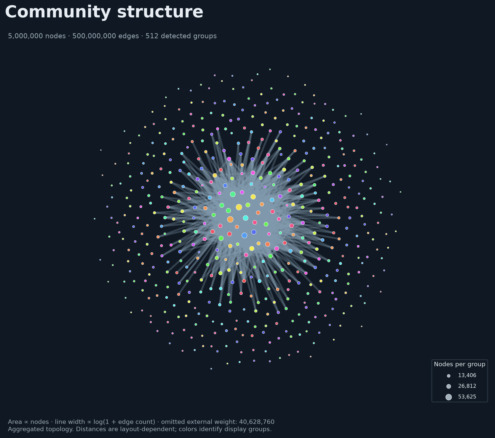

# Individual scripts and research workflows

The primary user workflow is documented in the [quickstart](quickstart.md).
This page retains the original individual view and experimental commands.

# largegraph-viz

Disk-backed analysis and visualization of edge lists larger than RAM. The target
workload is **5 million nodes and 500 million undirected edges on a CPU-only
machine with 8 GB RAM**. An actual synthetic run at that scale completed under a
verified **8,000,000,000-byte cgroup limit with swap disabled**, using two threads.
Generation and the full pipeline took about **16.5 minutes**, with a largest
sampled stage process-tree RSS of **4.15 GB**. See [measured verification](verification.md)
for hardware, raw evidence, view settings and limitations; timing is specific to that workstation.

Three views share one cached reduction:

| Command/script | Result | Interpretation |
| --- | --- | --- |
| `community` / `community_view.py` | Weighted node-link diagram, PNG/PDF/SVG and CSV | Relationships between detected groups |
| `matrix` / `matrix_view.py` | Raw, density and degree-adjusted block matrices | Connectivity without depending on layout geometry |
| `density` / `density_view.py` | Raster maps, raw pixel arrays, coordinates | Aggregated topology at multiple display caps, or all supplied node coordinates |

Actual 5M-node / 500M-edge output, showing all 512 detected groups:



[Connectivity matrices](../examples/figures/full-matrix.png) ·
[Multiscale density map](../examples/figures/full-density.png) ·
[Bridge-scenario example](../examples/figures/bridge-communities.png) ·
[Archived measurements](../examples/results/README.md)

Community counts and quotient edge weights use the **whole input**, not an edge
sample. Detection is heuristic. Figure filtering and artificial `Other` groups
are disclosed in both captions and manifests. An aggregated raster is never
presented as a recovered layout of every original node.

## Install

Linux, Python 3.11 or newer, no GPU. Run from this directory:

```bash
python3 -m venv .venv
python -m pip install -e '.[images,leiden,validation]'
```

Alternatively, with uv:

```bash
uv sync --locked --extra images --extra leiden --extra validation
```

`sfdp` from Graphviz is optional. Layout falls back to igraph's compiled
Fruchterman–Reingold implementation, always on a bounded display graph.
CluStRE is an optional external backend; see [its integration guide](clustre.md).

## First images

```bash
.venv/bin/python scripts/generate_graph.py \
  --config configs/small.json --output data/demo --nodes 10000 --edges 100000 \
  --communities 12 --mixing 0.08 --seed 42 --memory 512MB

.venv/bin/python scripts/render_all.py data/demo/edges.csv \
  --nodes-file data/demo/nodes.csv --truth data/demo/nodes.csv \
  --work-dir work/demo --output runs/demo --memory 512MB \
  --levels 16 64 128 --max-groups 128 --pixels 1024 --reference --hash-input
```

Open `runs/demo/community/communities.png`, `runs/demo/matrix/matrix.png`, and
`runs/demo/density/density_128.png`. Each also has a PDF and SVG version.
`runs/demo/validation/validation.json` contains conservation checks, planted-label
recovery and the bounded Leiden comparison. `pipeline.json` points to the exact
cached artifacts used by the figures.

For individual views, replace `render_all.py` with `community_view.py`,
`matrix_view.py`, or `density_view.py` and use a separate output directory.
Every view accepts the original CSV and reuses cached preparation and detection.

## Input contract

```csv
source,target
alice,bob
bob,charlie
```

The initial version handles **undirected, unweighted, simple graphs**. Endpoints
are strings, preserving identifiers such as `001`. It canonicalizes undirected
pairs, removes loops, deduplicates repeated/reversed edges, and reports all such
changes. Missing endpoints and malformed rows fail. Directions and weights are
not inferred. Extra columns fail unless `--ignore-extra-columns` explicitly opts
into discarding them. Only use undirected interpretation for data where that is
scientifically appropriate.

Options include `--source`, `--target`, `--delimiter`, `--nodes-file` and
`--node-column`. The optional node CSV includes isolated nodes; endpoints found
in the edge CSV are retained even if absent from the node CSV. CSVs need headers.
Ground-truth files are used by validation only. The generator randomizes node IDs
so adjacency order does not directly expose planted blocks.

The archived exact 512-community graph in `examples/full-quotient` is small enough
to inspect directly. Its Parquet edge weights sum to all 500 million original
edges; internal edges occupy the diagonal once. It can also be rendered through
the Python API without the original CSV:

```python
from pathlib import Path
from largegraph_viz.runtime import Resources
from largegraph_viz.views import render_community

render_community(Path("examples/full-quotient"), Path("runs/from-summary"),
                 Resources(), max_groups=512)
```

Preparation assigns stable, lexicographically ordered compact IDs. The mapping
is saved as `nodes.parquet` (`node_id`, `original_id`). If genuine coordinates are
available, create an `N × 2` numeric `.npy` array in this compact ID order:

```bash
.venv/bin/python scripts/density_view.py edges.csv --nodes-file nodes.csv \
  --coordinates xy.npy --work-dir work/real --output runs/coordinates
```

This mode bypasses detection and counts every node in fixed-size pixel grids.
It does not generate or interpolate coordinates.

## Resource controls

Start with `--memory 3GB --threads 2 --batch-rows 250000`. `--memory` controls
DuckDB's buffer budget, **not total process RSS**. NumPy, Arrow, JIT compilation,
layout libraries, and figure buffers need additional memory. Manifests record
sampled peak process-tree RSS, wall time and working disk usage. Do not run
several full pipelines concurrently on an 8 GB machine.

Provide an SSD workspace, initially around 100 GB free for the target scale.
This is an estimate: external sorting, strings and duplicate rates can change it
substantially. `--temp-dir /path/on/ssd --temp-limit 80GB` controls spill storage.
All temporary graph structures stay on disk. Flat adjacency is read in bounded
blocks, rather than mapping and touching the complete edge array.

`--passes` controls native clustering scans (default 5). Each pass additionally
scans canonical edges to evaluate its exact modularity. More passes trade time
for local refinement; they do not guarantee global optimality. `--resolution`
changes the modularity objective. `--max-groups` defaults to 128 and cannot exceed
1024; the remaining communities are explicitly grouped as artificial `Other`.
Full detected assignments and quotient weights are retained on disk.

`--max-edges` controls image filtering only. `--levels 32 128 512` selects nested
display reductions; layouts at each level are computed independently. `--pixels`
is limited to 64–4096 to bound image memory. The scientific meaning of these
choices is detailed in [methodology](methodology.md).

## Benchmarks and scientific checks

```bash
.venv/bin/python -m pytest -q
.venv/bin/ruff check .

.venv/bin/python scripts/benchmark.py --output runs/benchmark \
  --sizes 10000 100000 --scenarios communities weak bridges core-periphery null \
  --seeds 42 43 44 --reference --memory 512MB --rss-limit-gb 6

.venv/bin/python scripts/benchmark.py --output runs/spill-test \
  --spill-only --spill-memory 64MB --spill-rows 4000000
```

For a hard memory constraint on a Linux machine with a systemd user manager:

```bash
.venv/bin/python scripts/constrained_run.py --output runs/limited \
  --memory-gb 8 --cpu-cores 8 -- \
  .venv/bin/python scripts/benchmark.py --output runs/limited-data \
  --sizes 100000 --mean-degree 200 --communities 32 --memory 3GB
```

The runner verifies actual cgroup limits, disables swap, records cgroup memory
(including page cache and children), and retains the command, trace and log.
The eight-core quota limits CPU time; it does not reproduce another CPU model.

The recorded target-scale benchmark used the same runner with
`--sizes 5000000 --mean-degree 200 --communities 512 --levels 32 128 512 --pixels 1024`.
Its cgroup report and pipeline manifests are archived under `examples/results`.

Each benchmark stage is a fresh subprocess. The sampled RSS guard terminates a
stage exceeding the requested threshold, but is not a hard operating-system RAM
limit. The spill experiment must observe nonzero temporary storage in DuckDB's
profile or monitoring data; a small successful run alone does not establish
out-of-core execution. See [the experimental protocol](experiments.md).

## Target-scale run

Run smaller benchmarks and check storage before starting this workload:

```bash
.venv/bin/python scripts/generate_graph.py --output data/full \
  --config configs/full.json

.venv/bin/python scripts/render_all.py data/full/edges.csv \
  --nodes-file data/full/nodes.csv --truth data/full/nodes.csv \
  --work-dir work/full --output runs/full --memory 3GB --threads 2 \
  --batch-rows 250000 --hash-input --levels 32 128 512 --max-groups 512
```

The generator produces exactly the requested number of **unique retained edges**,
not just that many raw proposals. Realized degrees and mixing differ from their
proposal parameters after removing duplicate/self edges. The model is precisely
specified in the methodology; it is not claimed to reproduce every property of
social networks or to be the canonical Bernoulli DC-SBM.

## Reproducibility and recovery

Generated datasets refuse to replace existing output. Prepared, clustered and
quotient artifacts are built under `.inprogress` directories and renamed only
after success. Interrupted work is retained for inspection. The new `analyze` workflow resumes completed preparation phases and native
clustering passes automatically. Legacy generator outputs keep their strict
no-overwrite contract; move an interrupted generation directory aside before retrying. Rendering may replace
its own output figures; use new run directories for paper experiments.

Caches include input paths, sizes, modification times, parsing choices and
algorithm parameters. `--hash-input` adds SHA-256 and is recommended for archived
experiments. A file-stat cache is a convenience, not a content integrity proof.
Exact library versions are saved in manifests. Keep the input data, manifests,
configuration and environment together when archiving results.

Generation accepts `--config configs/small.json` or `--config configs/full.json`;
explicit command-line flags override JSON defaults. Check dependencies and the
provisional disk budget with `python scripts/doctor.py --target-scale`.

Read [the resource budget](resource-budget.md), [scientific methodology](methodology.md)
and [references](references.bib). See [verification status](verification.md)
for what was actually executed in the development environment. Synthetic output,
workspaces and benchmark runs are excluded from Git.
